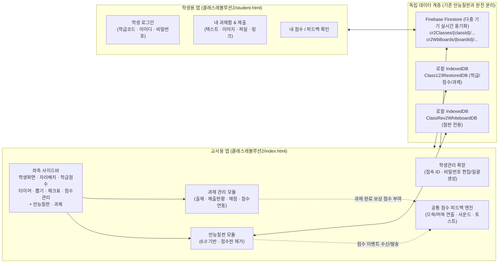
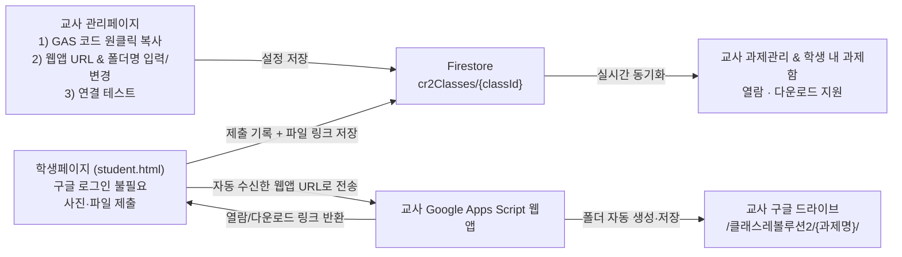

# 클래스레볼루션2 — 만능칠판 6.0 & 과제(교사/학생) 모듈 통합 기획서

> [!IMPORTANT]
> 본 기획서는 기존 만능칠판과 **데이터를 100% 분리**하면서 `클래스레볼루션2` 내부에 만능칠판 6.0 기능(점수판 제외)과 과제 기능(교사용 뷰 + 학생용 별도 로그인 페이지 + 학생관리 ID/PW 편집)을 네이티브 통합하는 설계안입니다.

---

## 1. 전체 아키텍처 개요



---

## 2. 좌측 사이드바 및 화면 전환 설계

현재 [index.html](file:///c:/Users/%EB%B0%A9%EC%86%A1%EC%8B%A4/Desktop/%EA%B0%9C%EB%B0%9C%EC%9A%A9%20%EC%86%8C%EC%8A%A4/class123-web/index.html)의 `.side-rail` (`수업도구` 그룹)에 2개 아이콘 버튼을 추가합니다.

| 메뉴명 | `data-mode` | 아이콘 | 배치 위치 | 동작 |
|---|---|---|---|---|
| **만능칠판** | `whiteboard` | 칠판/판서 아이콘 | `수업도구` 그룹 (타이머·뽑기·체크표·점수관리 하단) | `#view-whiteboard` 활성화 (이식된 만능칠판 6.0 실행) |
| **과제** | `assignments` | 과제/노트 아이콘 | `수업도구` 그룹 (만능칠판 하단) | `#view-assignments` 활성화 (교사용 과제 관리 대시보드) |

- **상단 헤더 연동**:
  - `whiteboard` 모드 진입 시 학생화면 전용 옵션(`#header-view-controls`: 번호/아바타/점수모드/정렬)은 자동 숨김.
  - 필요 시 칠판 작업 공간 극대화를 위해 `헤더 접기/전체화면` 토글 버튼 제공.

---

## 3. 모듈 1: 만능칠판 6.0 이식 설계

### 3-1. 이식 원칙 (독립 이식 · 기존 앱 무간섭)
- **기반 소스**: 워크스페이스 내 만능칠판 6.0.0 (`mouse/클래스레볼루션/modules/whiteboard/`)을 `class123-web/modules/whiteboard/`로 복사·정리해 `클래스레볼루션2` 내부 자산으로 완전 독립시킴.
- **기존 만능칠판과 데이터 100% 분리**:
  | 저장소 구분 | 기존 만능칠판 6.0 | 클래스레볼루션2 이식 만능칠판 |
  |---|---|---|
  | IndexedDB | `WhiteboardPagesDB:{scope}` | **`ClassRev2WhiteboardDB`** |
  | localStorage / Signal | `whiteboard-pages-signal:{scope}` | **`cr2-wb-signal`** |
  | BroadcastChannel | `whiteboard-pages:{scope}` | **`cr2-wb-channel`** |
  | SessionStorage | `whiteboard-pages-session:{scope}` | **`cr2-wb-session`** |
  | Firebase Firestore | `wbBoards/{boardId}` | **`cr2WbBoards/{boardId}`** |
  | 기기 연결 키 접두사 | `WB5.` | **`CR2WB.`** |

### 3-2. 점수판 기능 제거 & 클래스레볼루션2 점수 통합
- **제거 대상**:
  - `modules/whiteboard/score/` 폴더 전체 (기존 6.0 점수판, 학급온도계, 목표 UI, 사운드 파일)
  - `#scorePanel`, `#scoreSplitter`, `#scorePanelToggle` DOM 및 점수판 단축키/초기화 코드
  - `js/shared-score.js` 기반의 자체 점수 동기화 로직
- **유지 대상 (만능칠판 6.0 핵심 기능 전부)**:
  - Fabric.js 캔버스 판서(펜·형광펜·도형·텍스트박스·지우개·선택·실행취소/다시실행)
  - 멀티 페이지 관리(추가·순서변경·복제·삭제·배경색/이미지 설정)
  - PDF/이미지 파일 삽입, 클립보드 붙여넣기, 화면 확대/축소/패닝
  - JSON 백업/복원 및 독립 클라우드 기기 연결(QR코드 포함)

### 3-3. 만능칠판 모듈 내 점수 피드백 연동
만능칠판으로 수업(판서)하는 도중에도 클래스레볼루션2의 점수 피드백(으쓱/머쓱 풀스크린 연출 + `Plus2`/`Minus2` 사운드)이 끊김 없이 재생되도록 설계합니다.

1. **연출 오버레이 최상위 유지**:
   - `#fx-stage` (`z-index: 800`)가 `#view-whiteboard` 위에 덮이므로, 만능칠판 사용 중에도 풀스크린 으쓱/머쓱 연출을 즉시 재생 가능.
   - `effects.js`의 `presentOutcome()` 허용 모드 목록에 `'whiteboard'` 추가 (`mode === 'whiteboard'`일 때도 토스트가 아닌 풀스크린 연출 재생, 단 판서를 가리지 않게 토스트 옵션 전환도 가능).
2. **만능칠판 안에서 점수 부여 진입점 2가지**:
   - **빠른 점수 부여 플로팅 버튼**: 만능칠판 우측 상단(또는 툴바 끝)에 작은 `으쓱/머쓱` 퀵 버튼 배치 → 클릭 시 학생 빠른 선택 + 기존 `openScoreComposer` 팝업 열림 → 확인 시 칠판 위에서 바로 으쓱/머쓱 연출 재생 후 칠판 복귀!
   - **다중 창/다중 기기 실시간 수신**: 교사가 보조 태블릿/다른 탭의 클래스레볼루션2 학생화면에서 점수를 주면 `BroadcastChannel` (`class123-restored-sync-v1`) 및 Firestore 리스너로 점수 이벤트를 수신해 전자칠판(만능칠판 화면) 위에 **자동으로 으쓱/머쓱 연출과 사운드를 송출**.

---

## 4. 모듈 2: 과제 기능 상세 명세 (교사용 & 학생용)

### 4-1. 접속 주소 구조 (GitHub Pages 정적 배포 호환)
- **교사용**: 기존 주소 그대로 `https://teneer.github.io/class_score/클래스레볼루션2/` → 좌측바 `과제` 아이콘 클릭.
- **학생용 (별도 접속 주소)**:
  - `https://teneer.github.io/class_score/클래스레볼루션2/student.html`
  - 교사 관리페이지에서 서버를 연결하면 **학생 전용 접속 URL + QR코드**가 자동 생성되어 학생은 별도 서버 설정 없이 바로 아이디/비번으로 로그인.

### 4-2. 교사용 과제 관리 기능 (`#view-assignments`)
1. **과제 대시보드 & 상단 도구**
   - 상태 필터(`진행 중` / `마감됨` / `임시저장` / `전체`), 과목 태그(`국어`·`수학`·`사회`·`과학`·`창의`·`기타`), 제목 검색.
   - 과제 카드별 제출률(`14 / 20명 제출`, 진행 바) 및 **미확인 새 제출물 배지(`NEW 3`)** 표시.
   - 상단 퀵 버튼: `[+ 새 과제 만들기]`, `[학생 접속 링크·QR]`, `[서버·구글드라이브 설정]`.
2. **과제 출제 · 수정 · 복제 · 마감**
   - 기본 정보: 제목, 과목 태그, 상세 안내문, 마감일시(선택), 지각 제출 허용 여부.
   - 교사 참고 자료 첨부(이미지·PDF 등 구글 드라이브 자동 저장).
   - 대상 범위: `학급 전체` 또는 `특정 모둠 / 개별 학생 선택`.
   - 허용 제출 형식(복수 선택): `워크시트(배경지 위 직접 작성)`, `텍스트 작성`, `사진/이미지(복수 장)`, `일반 파일(PDF·문서 등)`, `외부 링크(URL)`.
   - **워크시트 템플릿(배경지) & 학생 도구 제한 & 경량 분리 저장**:
     - **배경지 선택**: 교사가 올린 학습지 이미지/PDF 페이지(과제당 **1회만 저장** — 구글 드라이브), 또는 내장 기본 배경지(`백지` · `줄노트` · `모눈종이` · `원고지`), 또는 만능칠판 캡처.
     - **학생 허용 도구 제한(체크박스)**: 교사가 과제별로 학생이 쓸 수 있는 도구를 켜고 끌 수 있음 (`펜`, `형광펜`, `텍스트 상자`, `지우개`, `사진 첨부`). 허용되지 않은 도구는 학생 툴바에서 숨김·차단되며 배경지는 고정 잠금.
     - **배경지 미중복 · 경량 답변 전송 & 실시간 합성**:
       - 학생 제출 시 **배경지는 저장/전송하지 않고**, 학생이 작성한 **답변 데이터(펜 벡터 경로·텍스트 상자 좌표/내용)**만 가벼운 JSON으로 서버(Firestore)에 전송.
       - 학생이 첨부한 **사진 파일만** 교사 구글 드라이브 `/클래스레볼루션2/{과제명}/`에 저장.
       - 교사/학생이 열람할 때 **공통 배경지 + 학생 답변 레이어를 실시간 합성**해 선명하게 표시 (필요 시 합성 PNG 다운로드 및 만능칠판 새 페이지로 보내기 지원).
   - 공개 설정: `교사만 보기(비공개)` / `우리 반 공유(친구 작품 서로 보기 — 미술·독후감 등)`.
   - 보상 점수 연동: 확인 시 원클릭으로 부여할 기본 `으쓱(+N점)`과 사유(`과제 완료: {과제명}`) 설정.
3. **채점 모드: 문항별 영역 크롭 일괄 채점 & 학생별 연속 채점**
   - **제출 현황판**: 학생별 상태 배지(`미제출` / `제출완료` / `지각제출` / `다시제출 요청` / `채점완료`), 필터 및 `미제출자 명단 복사`.
   - **모드 A — 문항별 채점 (영역 박스 크롭 일괄 채점)**:
     1. **문항 영역 박스 지정**: 교사가 과제 배경지 위를 드래그해 문항별 영역 박스(예: `1번 · 10점`, `2번 · 15점`)를 정규화 좌표(`x, y, w, h`)로 등록·편집.
     2. **문항별 전체 학생 크롭 그리드**: 특정 문항을 선택하면 **제출한 모든 학생의 답안지(배경지+답변 합성)에서 해당 박스 영역만 정확히 크롭**해 한 화면에 카드 그리드로 배치 (`미채점만 보기`, `익명 채점` 토글 지원).
     3. **다중 선택 / 전체 선택 일괄 채점 & 피드백**:
        - 답안 카드를 클릭해 다중 선택하거나 `[전체 선택]` / `[미채점 전체 선택]` 사용.
        - 액션 바에서 한 번에 **`○ 정답(만점)` / `× 오답(0점)` / `△ 부분점수(점수 직접 입력)`** 부여.
        - **선택 학생 일괄 피드백** 또는 **개별 학생 문항 피드백** 입력 지원.
     4. **총점 자동 합산**: 각 문항 점수가 합산되어 학생별 총점과 문항별 정답률이 자동 계산됨.
   - **모드 B — 학생별 채점 & 연속 확인**:
     - 한 학생의 전체 답안지(배경지+답변 합성), 문항별 채점 결과, 첨부 사진(미리보기·열람·다운로드)을 확인하고 좌/우 버튼으로 다음 학생 연속 채점.
     - **`★ 으쓱 점수 주기` 원클릭 버튼 / 제출자 일괄 점수 부여**: 클래스레볼루션2 점수 엔진·연출과 직접 연동 (중복 지급 방지).
   - **체크표 연동**: 선택한 과제의 제출 완료 여부를 클래스레볼루션2 `체크표` 항목으로 원클릭 반영.

### 4-3. 학생용 로그인 & 과제 페이지 (`student.html`)
1. **자동 서버 종속 & 간편 로그인**
   - 교사가 발급한 링크/QR로 1회 접속 시 서버 정보 자동 저장 → 다음부터는 **`아이디 + 비밀번호`**만 입력해 로그인.
   - 공용 크롬북/태블릿 환경을 고려해 우측 상단 `로그아웃` 버튼 상시 표시.
2. **학생 홈 헤더**
   - 내 아바타, 번호·이름, 현재 `쑥쑥점수` / `으쓱` / `머쓱` 현황(읽기 전용) 표시.
3. **내 과제함 (탭 구성)**
   - **할 과제**: 미제출 및 `다시제출 요청` 과제를 마감 임박순으로 표시 (`다시제출 요청`은 상단 강조 + 교사 코멘트 표시).
   - **제출한 과제**: `제출완료` / `확인완료` 내역, 선생님 피드백 도착 알림, 획득 점수 확인.
   - **친구 작품 보기**: 교사가 공유형으로 열어둔 과제에 한해 반 친구들의 제출물 열람.
4. **과제 제출 · 수정 · 내 파일 열람/다운로드**
   - 과제 안내 및 교사 첨부 자료 열람/다운로드.
   - 텍스트 입력, 사진/파일 첨부(카메라 촬영·파일 선택 → 교사 구글 드라이브 `/클래스레볼루션2/{과제명}/` 업로드 및 진행률 표시), 링크 입력.
   - 제출 완료 후 **본인이 제출한 사진·파일 미리보기 · 새 창 열람 · 다운로드** 가능.
   - 교사 확인 완료 전(또는 `다시제출 요청` 시)에는 자유롭게 수정·재제출 가능.

### 4-4. 상호작용 퀴즈 (외부 AI 연동 CSV · 개인과제형 & 실시간 퀴즈형)
전 과목에서 외부 AI(ChatGPT·Gemini 등)를 활용해 1분 만에 퀴즈를 만들어 바로 배포할 수 있도록 설계합니다.

1. **외부 AI 전달용 양식 CSV 다운로드 + 작업 지침 프롬프트 제공**
   - 과제 출제 화면에 **`[AI 퀴즈 양식 CSV 다운로드]`** 버튼과 **`[AI 작업 지침 프롬프트 복사]`** 버튼 제공 (UTF-8 BOM 적용으로 엑셀·AI 한글 깨짐 방지, CSV 파일 안에도 기본 작성 지침 포함).
   - 교사는 자신의 수업 참고자료(PDF·교과서·요약본)와 함께 양식 CSV + 지침 프롬프트를 외부 AI에 전달해 즉시 퀴즈 CSV를 생성.
   - **표준 CSV 컬럼 규격**:
     `문항번호, 유형(객관식/OX/단답형), 문제내용, 보기1, 보기2, 보기3, 보기4, 보기5, 정답, 배점, 해설`
     - `객관식`: 보기1~5 중 2~5개 입력, 정답은 보기 번호(`1`~`5`).
     - `OX`: 보기 비워도 자동으로 O/X 버튼 구성, 정답은 `O` 또는 `X`.
     - `단답형`: 복수 정답 지원(`|` 구분, 예: `광합성|식물의 광합성`, 공백·대소문자 유연 채점).
2. **CSV 탑재 (파일 업로드 / 텍스트 붙여넣기) & 편집**
   - 외부 AI가 만든 `.csv` 파일을 올리거나, AI 답변 텍스트를 그대로 붙여넣기만 해도 자동 파싱.
   - 배포 전 문항별 미리보기·수정·삭제·배점 조정 가능.
3. **2가지 진행 모드 모두 지원**
   - **개인과제형 퀴즈**: 학생이 `student.html`에서 자기 속도로 문항을 풀고 제출 → 자동 채점 + 설정에 따라 즉시/마감 후 정답·해설 공개.
   - **실시간 퀴즈형**: 교사가 전자칠판에서 문항을 하나씩 진행(`시작 → 다음 문항 → 정답·해설 공개`)하면 접속한 학생 화면이 실시간 동기화되며, 교사 화면에 실시간 응답률·보기 분포·문항별 정답률이 표시됨.
4. **자동 채점 + 유사답안 보정 + 점수 연동**
   - 객관식·OX·단답형 자동 채점 후, 단답형 오타·유사답안은 문항별 채점 화면에서 교사가 일괄 정답 인정 가능.
   - 퀴즈 완료자/정답자에게 클래스레볼루션2 **으쓱 점수 원클릭 부여**(연출 연동).

### 4-5. 안전장치 및 예외 처리
- **파일 용량 안내**: 구글 드라이브 연결 시 파일당 최대 20MB 업로드 지원, 미연결 로컬/폴백 모드에서는 이미지 자동 압축 저장.
- **권한 분리**: 학생은 본인의 제출물(및 공유 허용 과제)만 조회 가능하며, 다른 학생의 비공개 제출물·교사 관리 기능은 차단.
- **임시 저장**: 작성 중 네트워크 오류가 발생해도 입력 텍스트를 브라우저에 임시 보관해 재제출 지원.

---

## 5. 모듈 3: 학생관리(학생설정) 접속 ID · 비밀번호 관리

현재 [students.js](file:///c:/Users/%EB%B0%A9%EC%86%A1%EC%8B%A4/Desktop/%EA%B0%9C%EB%B0%9C%EC%9A%A9%20%EC%86%8C%EC%8A%A4/class123-web/js/views/students.js)의 학생 데이터 스키마 및 학생관리 모달을 확장합니다.

### 5-1. 학생 데이터 스키마 확장 (`store.js`)
```js
{
  id: 'st-1',
  number: 1,
  name: '김하늘',
  // ...기존 필드 유지...
  loginId: 's01',         // 접속용 아이디 (학급 내 중복 불가, 영문/숫자/한글 허용 또는 영문+숫자)
  loginPw: '1234',        // 접속용 비밀번호 (관리자 편집 가능, 초기값 설정 가능)
  loginEnabled: true,     // 개별 학생 접속 허용/차단 토글
}
```
> [!NOTE]
> 초등 학급 현장 특성상 학생이 비밀번호를 자주 잊어버리므로, 교사가 학생관리 화면에서 비밀번호를 직접 편집·확인(눈 아이콘으로 가림/보기 토글)하거나 초기화할 수 있도록 설계합니다.

### 5-2. 학생관리 UI 개선
1. **개별 학생 편집 모달**:
   - 기존 `번호 / 이름 / 성별 / 아바타` 아래에 **`학생 접속 계정`** 섹션 추가:
     - 접속 아이디 입력란 (중복 실시간 검사)
     - 접속 비밀번호 입력란 (보기/숨기기 토글)
     - 접속 허용 스위치
2. **일괄 계정 생성/관리 도구** (교사 편의 기능):
   - `[아이디/비번 일괄 자동 생성]` 버튼: 예) 번호 기반 `s01`~`s20` + 초기 비밀번호 `1234` 또는 4자리 랜덤 숫자 일괄 부여.
   - `[학생 로그인 안내표 인쇄/복사]` 버튼: 번호·이름·아이디·비밀번호·접속 QR코드를 표로 출력해 교실에서 배부 가능.

---

## 6. 서버 자동 종속 접속 & 구글 드라이브 연동 설계

### 6-1. 관리페이지 단일 서버 연결 → 학생페이지 자동 접속
- **교사 관리페이지에서만 1회 설정**:
  - 설정 > `서버·드라이브 연결` 탭에서 Firebase 웹 앱 설정을 입력·저장(언제든 변경/해제 가능).
  - 연결 즉시 **해당 관리페이지에 종속된 학생 전용 접속 URL 및 QR코드**가 자동 생성됨 (`student.html#CR2S.{인코딩된_학급_서버정보}`).
- **학생페이지(`student.html`) 자동 접속**:
  - 학생은 별도의 서버 설정이나 학급코드 입력 없이 **전용 링크/QR로 접속하는 즉시 관리페이지 서버에 자동 연결**되며, 브라우저에 연결 정보가 저장되어 다음 접속부터는 **`아이디 + 비밀번호` 입력만으로 바로 로그인**함.
  - 교사가 관리페이지에서 서버를 변경하면 새 학생 접속 링크/QR이 즉시 발급되어 일괄 교체 가능.

### 6-2. 구글 드라이브 내 `클래스레볼루션2` 폴더 대용량 파일 저장
학생(구글 계정 로그인 없음)이 사진·PDF·문서 등 대용량 과제 파일을 제출해도 교사의 구글 드라이브에 안전하게 저장되도록 **Google Apps Script(GAS) 웹앱 브리지** 방식을 사용합니다.



- **관리페이지 설정 및 변경 기능**:
  - **GAS 스크립트 원클릭 복사 + 3단계 배포 가이드** 내장 (교사가 `script.google.com`에 붙여넣고 웹앱 배포만 하면 끝).
  - **웹앱 URL 입력·변경·연결 테스트 버튼** 및 **저장 폴더명 설정**(기본값: `클래스레볼루션2`, 원할 때 변경 가능).
  - 폴더 자동 정리: `구글 드라이브 / 클래스레볼루션2 / {과제명} / {번호}_{이름}_{원본파일명}`.
  - 드라이브 미연결 상태에서도 소용량 사진(자동 압축)은 로컬/Firestore로 폴백 제출 가능.
- **열람 및 다운로드**:
  - **학생**: `student.html`의 `내 제출 과제`에서 본인이 올린 사진 미리보기 · 새 창 열람 · 파일 다운로드 가능.
  - **교사**: `과제관리`에서 학생별 제출 파일 미리보기 · 열람 · 다운로드 및 드라이브 폴더 바로가기 지원.

### 6-3. Firestore 컬렉션 구조 (기존 만능칠판과 완전 분리)
- `cr2Classes/{classId}`: 학급 기본 정보, 설정, `driveBridgeUrl`, `driveFolderName`
- `cr2Classes/{classId}/students/{studentId}`: 학생 명렬, 점수, `loginId`, `loginPw`, `loginEnabled`
- `cr2Classes/{classId}/assignments/{assignmentId}`: 과제 정보(제목·설명·마감일·제출형식·보상점수)
- `cr2Classes/{classId}/assignments/{assignmentId}/submissions/{studentId}`: 학생별 제출 텍스트·구글드라이브 파일 목록(`name`, `mimeType`, `size`, `viewUrl`, `downloadUrl`)·제출시각·교사 피드백·점수지급여부
- `cr2Classes/{classId}/liveEvents/{eventId}`: 실시간 점수 피드백 브로드캐스트(보조 기기에서 점수 부여 시 전자칠판/만능칠판에서 연출 재생)
- `cr2WbBoards/{boardId}/...`: 만능칠판 6.0 전용 데이터(기존 `wbBoards`와 완전 분리)

---

## 7. 단계별 구현 로드맵

| 단계 | 작업 내용 | 주요 산출물 |
|---|---|---|
| **1단계** | **만능칠판 6.0 독립 이식 + 점수판 제거 + 점수 피드백 연동** | `modules/whiteboard/`, `js/views/whiteboard.js`, 좌측바 아이콘, 퀵 점수 부여 & `#fx-stage` 연동 |
| **2단계** | **학생관리 접속 ID/PW 편집 및 일괄 생성** | `js/store.js` 스키마 확장, `js/views/students.js` 학생관리 UI, 로그인 안내표 |
| **3단계** | **교사용 과제 모듈 구현** | `js/views/assignments.js`, `styles/assignments.css`, 좌측바 아이콘, 제출 현황/피드백/점수 연동 |
| **4단계** | **학생용 별도 로그인 페이지(`student.html`) + Firebase 실시간 동기화** | `student.html`, `js/student-app.js`, `js/cloud-sync.js`, `firestore.rules`, QR 접속 링크 |
| **5단계** | **통합 검증 및 GitHub Pages 배포** | 문법/기능 점검, 데이터 격리 검증, `클래스레볼루션2/` 푸시 |

---

## 8. 2차 고도화 확장 기획 (신규 추가)

### 8-1. 만능칠판 모듈 내 자유 플로팅 패널 (`학생목록` · `자리배치` · `학급점수`)
- **제공 패널 3종**: 만능칠판 우측 상단(또는 도구바)에서 **`학생목록` / `자리배치` / `학급점수(황금알)`** 패널을 각각 자유롭게 띄우거나 탭으로 전환.
- **창 조작 기능**:
  - **자유 이동**: 패널 상단 헤더를 드래그해 칠판 위 원하는 위치에 배치.
  - **창 크기 조절(리사이즈)**: 패널 우하단 핸들 드래그로 가로·세로 크기 자유 조절.
  - **내용 확대/축소(Zoom)**: 패널 헤더의 `− / 100% / +` 버튼으로 내부 카드·글씨 배율 조절 + 최소화(접기)/닫기.
- **실시간 연동**: 플로팅 패널에서 학생을 선택해 `으쓱/머쓱` 점수를 부여하면 만능칠판 위에서 점수 피드백 연출이 즉시 재생되며 본 화면과 실시간 동기화.

### 8-2. 문항별 채점 영역 UX 고도화 (학생 답지 직접 지정 · 영역 수정 · 전체 시험지 확대)
- **학생 답지 위에서 바로 영역 지정**: 빈 배경지뿐 아니라 **실제 제출된 학생 답지 화면 위에서 바로 마우스로 드래그해 문항 채점 영역 박스 생성** 가능.
- **영역 수정 기능**: 등록된 문항 박스의 **위치 드래그 이동 · 모서리 크기 조절 · 문항명/배점 수정**을 언제든 실시간으로 반영.
- **문항별 채점 ↔ 전체 시험지 확대 보기 연동**:
  - 문항별 크롭 그리드에서 특정 학생 답안(또는 확대 버튼)을 클릭하면 **해당 학생의 전체 시험지(배경지+답변 합성)를 대형 모달로 표시**.
  - **전체 시험지 확대 모달 안에서도 채점 영역 박스를 즉시 수정**할 수 있으며, 닫는 즉시 문항별 크롭 그리드에 새 영역이 반영됨.

### 8-3. 체크표 연동 고도화 (유형 선택 · 중간 변경 · 점수 자동 입력)
- **지원 연동 유형 (2종)**:
  1. **`체크표 (제출 여부 ☑)`**: 과제 제출 완료 학생 자동 체크.
  2. **`점수 (자동 입력)`**: 문항별 채점 총점 또는 퀴즈 자동 채점 점수를 체크표 셀에 **자동 입력**.
- **중간 유형 변경 지원**:
  - 예) 과제 출제 직후에는 `체크표(제출 여부)`로 연동했다가, 채점이 끝난 뒤 중간에 **`점수 입력`으로 변경**하면 기존 체크표 열이 점수 열로 전환되면서 채점 점수가 자동 동기화됨 (반대 방향 전환도 지원).

### 8-4. 과제 배경지 PDF · HWPX 및 다중 페이지(여러 쪽) 지원
- **다중 형식 지원**:
  - **이미지**: PNG/JPG/WEBP (여러 장 동시 업로드해 다중 페이지 구성 가능).
  - **PDF**: 클라이언트에서 PDF.js로 각 페이지를 고해상도 이미지로 변환해 전체 쪽 또는 선택한 쪽을 배경지로 등록.
  - **HWPX (한글 문서)**: 브라우저에서 `.hwpx` ZIP/XML(`Contents/section*.xml` + `BinData/*`)을 직접 파싱해 본문·표·이미지를 A4 페이지 단위로 렌더링해 배경지로 변환 *(복잡한 편집 서식은 PDF 변환 업로드도 병행 지원)*.
- **다중 페이지 워크시트 & 채점 연동**:
  - `template.pages = [{ pageIndex, imageUrl, width, height }, ...]` 구조로 확장.
  - 학생은 `◀ 1 / N쪽 ▶` 페이지 전환으로 각 쪽 위에 작성(배경지 미전송, 쪽별 경량 답변 JSON만 저장).
  - 문항 채점 영역 박스에도 `pageIndex`를 포함해 여러 쪽 시험지에서도 문항별 크롭 채점이 그대로 동작.

### 8-5. 학생 셀프 체크표 (전자칠판 터치용 5열/10열 & 학생 태블릿 퀘스트용)
세로 명렬표가 아닌 **버튼형/카드형 셀프 체크표**를 2가지 방식으로 제공합니다.

| 구분 | 전자칠판 터치용 (교실 공유 화면) | 학생 태블릿 퀘스트용 (`student.html`) |
|---|---|---|
| **배치 형태** | 학생 번호·이름 버튼/카드를 **5열 또는 10열 그리드**로 전환 배치 | 전체 명단 없이 **본인의 퀘스트 카드만** 깔끔하게 표시 |
| **사용 예시** | 아침 등교 출석, 숙제 제출, 우유/급식 확인 등 학생이 칠판에 나와 자기 번호 터치 | 교사가 보낸 퀘스트(예: *휴대폰 끄기*, *발표 5번*, *사물함 청소*)를 자기 태블릿에서 직접 체크 |
| **체크 유형** | 단일 완료 터치 (`미완료 ↔ 완료`) 또는 횟수 카운트 (`+1`) | 단일 체크(`☑ 완료`) 및 목표 횟수형(`3 / 5회` 진행 바 + `+1` 버튼) |
| **연동 기능** | **만능칠판 내 플로팅 패널로도 띄워 사용** 가능 · 기존 **`체크표` 모듈과 실시간 양방향 동기화** | 태블릿에서 체크 시 교사 체크표 & 전자칠판 패널에 실시간 반영 · 퀘스트 완료 시 으쓱 점수 연동 |

### 8-6. 대상 학생 전체 / 일부 선택 배포 & 학생 과제 → 만능칠판 원클릭 불러오기
- **전체 / 일부 학생 선택 배포 (과제 · 퀘스트 공통)**:
  - 과제 및 셀프 퀘스트 출제 시 `학급 전체` 또는 `일부 선택(모둠 단위 / 개별 학생 체크)` 지정 가능 (`targetStudentIds: null | string[]`).
  - 일부 학생에게만 배정된 과제·퀘스트는 **배정된 학생의 `student.html`에만 노출**되며, 교사 제출률·현황판도 배정된 대상 인원 기준으로 자동 계산됨.
- **학생 과제 제출물 → 만능칠판 원클릭 불러오기 (개별 · 다중 선택 · 전체 선택)**:
  - 교사 과제관리(학생별 채점 뷰어 / 문항별 채점 그리드)에 **체크박스 다중 선택 및 `[전체 선택]`** + **`[🖍️ 만능칠판으로 보내기]`** 버튼 추가.
  - 1명 또는 여러 명의 학생 과제(워크시트 배경지+답변 합성 PNG, 문항 크롭 이미지, 첨부 사진)를 `postMessage` 브리지로 만능칠판 6.0에 한꺼번에 전송.
  - 만능칠판 6.0의 다중 이미지 배치 모달(`1열 · 2열 · 3열 · 4열 격자 배치` 또는 `한곳에 겹치기`)과 그대로 연동되어 여러 학생의 답안을 한 화면에 나란히 띄워 비교·빨간펜 첨삭 가능.

---

### 2차 고도화 구현 순서 (권장)
1. **Phase A**: 만능칠판 자유 플로팅 패널(`학생목록` · `자리배치` · `학급점수` 이동/리사이즈/확대·축소) + 학생 과제 → 만능칠판 원클릭 불러오기 브리지
2. **Phase B**: 문항별 채점 영역 고도화(학생 답지 직접 영역 지정/수정 + 전체 시험지 확대 보기 내 영역 수정), 과제·퀘스트 전체/일부 학생 선택 배포 & 체크표 연동 유형 선택/중간 변경(`체크 ↔ 점수 자동입력`)
3. **Phase C**: 과제 배경지 PDF · HWPX 파서 및 다중 페이지(여러 쪽) 워크시트 지원
4. **Phase D**: 학생 셀프 체크표(전자칠판 5열/10열 버튼형 + 만능칠판 패널 연동 + 학생 태블릿 퀘스트 체크)
